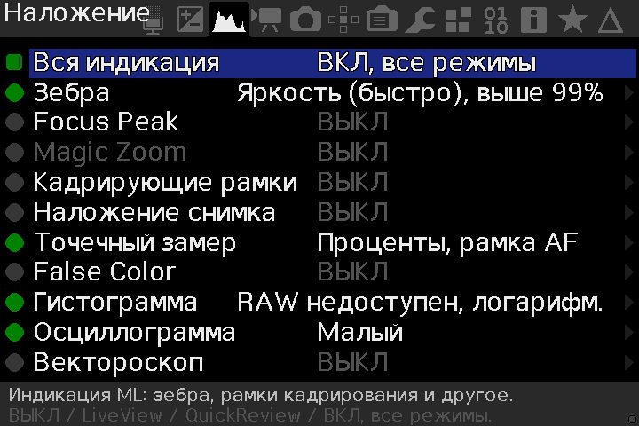
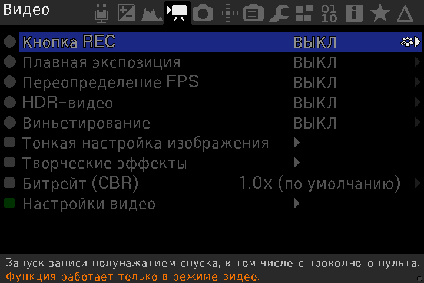
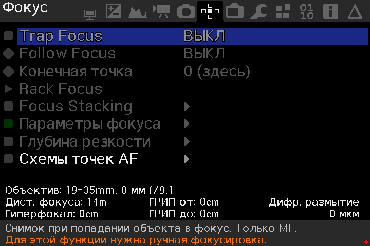
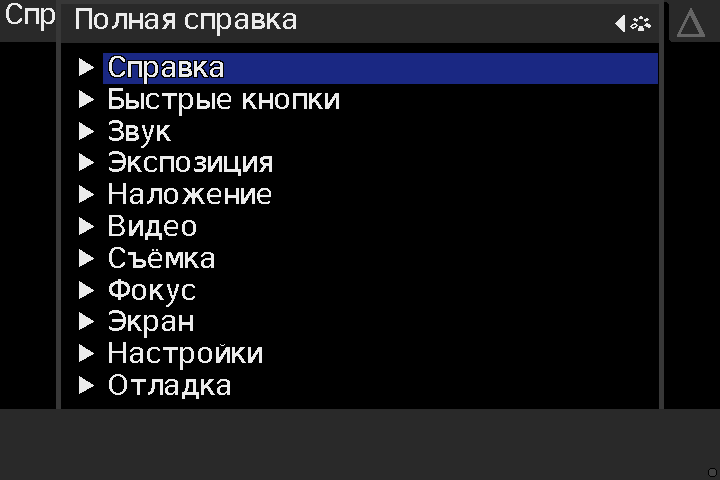
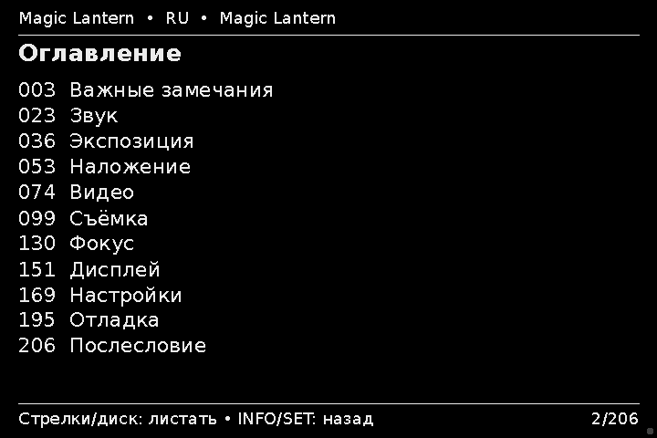
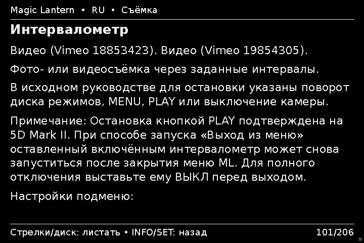

# Magic Lantern RU — русификация для Canon EOS 5D Mark II

Magic Lantern на русском языке для Canon EOS 5D Mark II
(5D2, 5D MK2) с прошивкой Canon 2.1.2.

Русские меню, подсказки и полная справка, инструкции установки
и готовые сборки. Перевод и адаптация — dimalishes.

Russian localization of Magic Lantern for Canon EOS 5D Mark II:
Russian menus, help pages, installation instructions and downloads.

**[Скачать сборку](https://github.com/dimalishes/magiclantern_simplified_ru/releases/tag/2026-10-28_5D2_ru.212)** ·
[Все выпуски](https://github.com/dimalishes/magiclantern_simplified_ru/releases) ·
[Исходный код](https://github.com/dimalishes/magiclantern_simplified_ru/tree/ru-5d2)

## Что переведено и исправлено

- Меню, подсказки и сообщения ML на русском языке.
- Переключение русского и английского языка.
- Полная русская справка: 206 страниц с переходами из пунктов меню.

Руководство описывает несколько моделей камер; часть функций на 5D Mark II
недоступна. Некоторые подписи на исходных иллюстрациях остаются английскими.

## Скачать и установить

Откройте **[релиз 2026-10-28_5D2_ru.212](https://github.com/dimalishes/magiclantern_simplified_ru/releases/tag/2026-10-28_5D2_ru.212)**
и выберите архив в разделе **Assets**:

| Архив | Когда выбирать |
| --- | --- |
| [Обновление — update.zip](https://github.com/dimalishes/magiclantern_simplified_ru/releases/download/2026-10-28_5D2_ru.212/2026-10-28_5D2_ru.212_update.zip) | На камере уже установлена и работает Magic Lantern. |
| [Чистая установка — clean_install.zip](https://github.com/dimalishes/magiclantern_simplified_ru/releases/download/2026-10-28_5D2_ru.212/2026-10-28_5D2_ru.212_clean_install.zip) | Для установки с нуля. Включает оригинальный установщик `ML-SETUP.FIR` для 5D2.212. |

**Только Canon EOS 5D Mark II / Canon 2.1.2.** Обновление самой прошивки Canon
в комплект не входит. Перед установкой сохраните фотографии и текущие файлы ML.
Копировать на CF-карту нужно содержимое выбранного архива, а не этот репозиторий.
Инструкции находятся внутри каждого ZIP.

[Инструкция обновления](https://github.com/dimalishes/magiclantern_simplified_ru/blob/ru-5d2/doc/ru/INSTALL-UPDATE.md) ·
[Инструкция чистой установки](https://github.com/dimalishes/magiclantern_simplified_ru/blob/ru-5d2/doc/ru/INSTALL-CLEAN.md)

После запуска кнопка **Delete** открывает меню ML, **INFO** — справку пункта.
Выбор языка: **Настройки → Язык меню**.

## Скриншоты

Примеры меню из эмулятора Canon EOS 5D Mark II и готовых страниц русской справки.

Основное меню

**Звук**

**Наложение**

**Видео**

**Фокус**

**Настройки**

Справочное меню

**Разделы полной справки**

**Оглавление**

**Зебра**

**Интервалометр**

## Проверка на камере

Проверен запуск на личной Canon EOS 5D Mark II / Canon 2.1.2:
обновление работающей ML и установка с нуля после полного удаления ML.

Другие камеры не проверялись.

Будьте осторожны при использовании на ответственных съёмках.

## Проект и авторство

Этот репозиторий — страница проекта Magic Lantern RU с описанием и скриншотами.
Исходники и установочные архивы находятся в
[magiclantern_simplified_ru](https://github.com/dimalishes/magiclantern_simplified_ru).

Русификация и адаптация: **dimalishes**. Основа —
[reticulatedpines/magiclantern_simplified](https://github.com/reticulatedpines/magiclantern_simplified),
исходный коммит `ed3e7c0dfacfdeaf3349dee73edf9e3621217462`.
Авторство Magic Lantern и лицензии исходного проекта сохранены:
[GNU GPL v2](COPYING),
[лицензия DejaVu](https://github.com/dimalishes/magiclantern_simplified_ru/blob/ru-5d2/localization/DejaVu-LICENSE.txt).

Russian localization / русификация Magic Lantern для Canon 5D Mark II (5D2).
